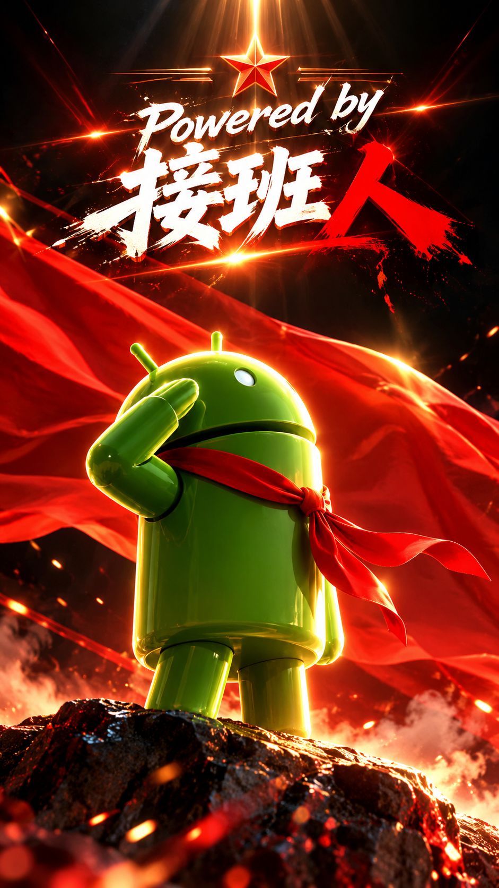
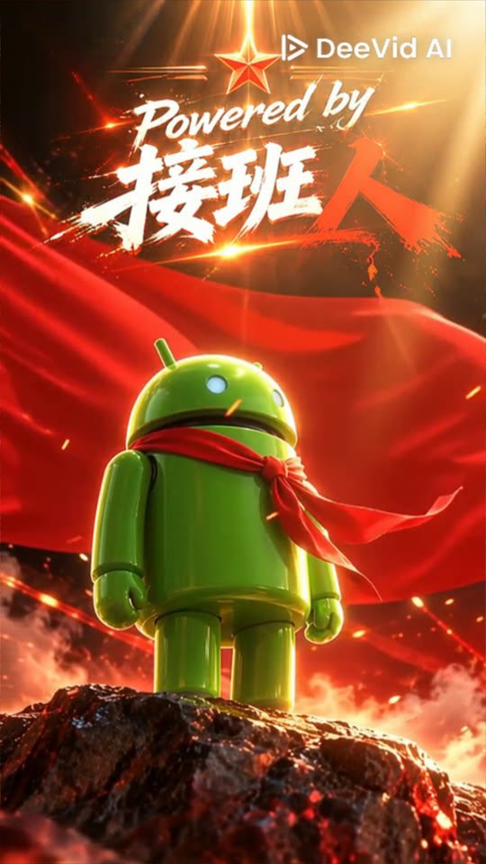
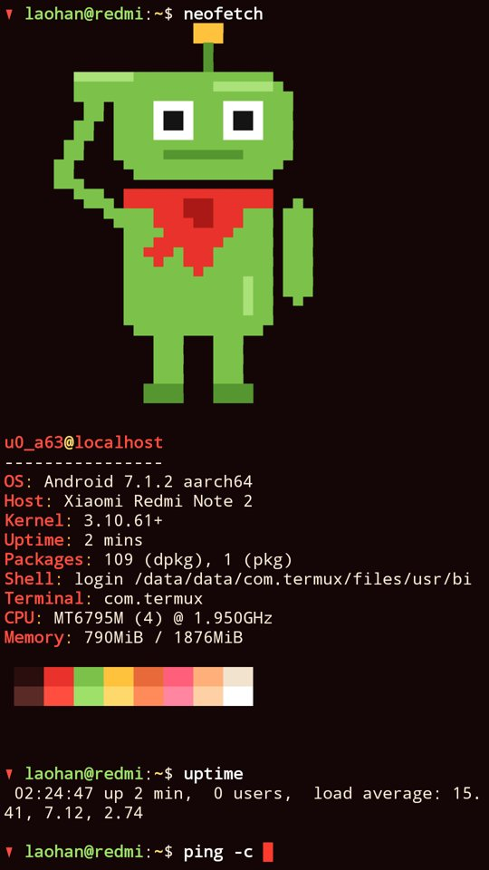
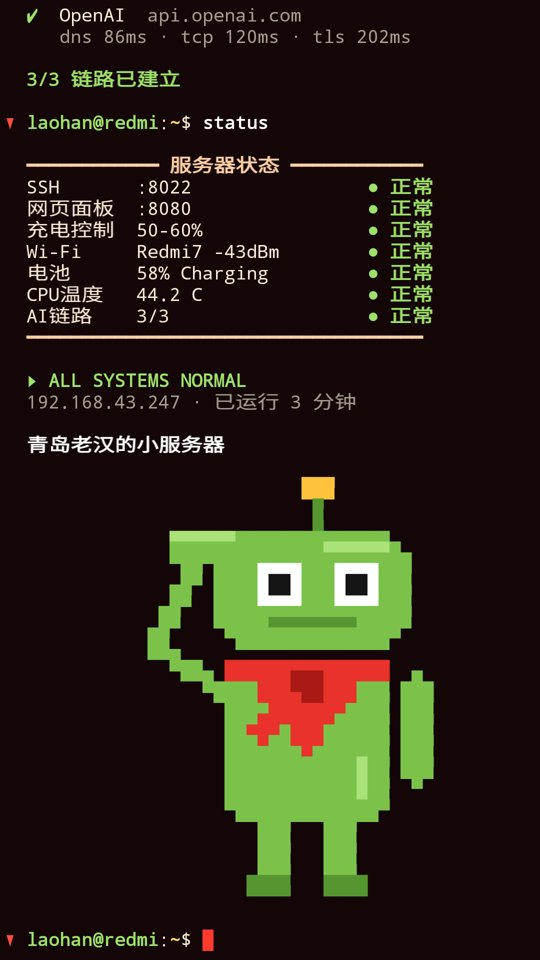
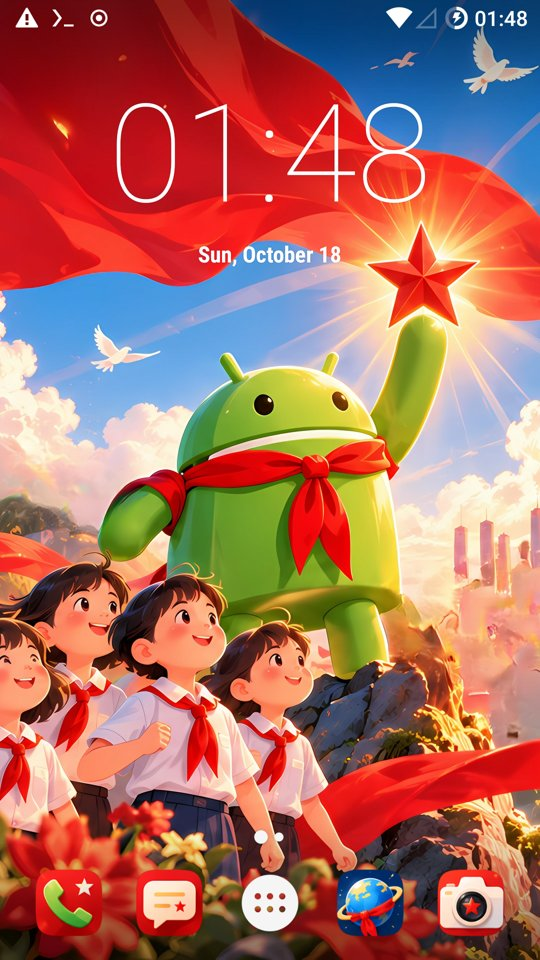
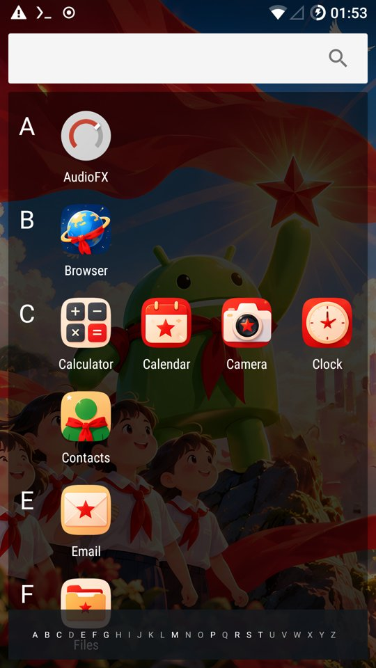

# redmi-note2-server

An old Redmi Note 2 (hermes, MT6795) running as an always-on LAN mini server. It runs LineageOS 14.1 and Termux.

- **Dashboard**: http://192.168.43.247:8080, reachable from anywhere on the LAN. Shows battery, Wi-Fi, CPU, temperatures, memory/storage and 24h trends. Refreshes every 5s.
- **Charge limiter**: keeps the battery between 50% and 60%. MTK's "stop charging" cuts the charger off completely, so the phone runs on its battery while charging is paused. Battery wear is therefore set by how much power the phone draws, not by how wide the window is. The screen now turns off after 60 s: draw fell from about 1.4 W to about 0.35 W, which is about 0.7 full cycles a day instead of 2. A thermal BCCT current limit (`/proc/driver/thermal/clbcct`) was tested as a power-path hold, but the thermal governor resets it within a second.
- **SSH**: `ssh -p 8022 192.168.43.247` (Termux, key auth).

## Screenshots

| Status dashboard | Boot animation | Boot intro (Termux) |
|---|---|---|
|  |  |  |

Dashboard on a phone: 

**Boot sound:** [assets/audio/phone_boot.mp3](assets/audio/phone_boot.mp3) (11 s, plays with the progress bar during the boot animation)

**Full step-by-step guide (Chinese, commands explained):** [docs/build-guide.html](docs/build-guide.html)

## Boot styles

Two boot styles so far. Check out the listed commits to see (or rebuild) each one.

### v2 "LOADING" (2026-10-17)

| | |
|---|---|
| First screen (logo partition) | `assets/images/boot-logo-v2-android.png`, 64 colours |
| Boot animation | `assets/images/bootanim-v2-portrait.png` + red LOADING progress bar (9 s) + `assets/audio/phone_boot.mp3` (11 s), 5 fps |
| Termux boot intro | typed commands, AI endpoint handshakes, status board; neofetch's stock Android logo |
| Commits | `3d08bbd` logo / boot-animation tools · `15cc746` progress-bar animation + boot intro · `def82f2` the v2 pictures and sound |

### v3 "接班人" (2026-10-18)

| First screen | Boot animation | Intro start | Intro end |
|---|---|---|---|
|  |  |  |  |

| | |
|---|---|
| First screen (logo partition) | `assets/images/boot-logo-v3-jiebanren.png`, 48 colours (1.75 MB; stock is 1.85 MB) |
| Boot animation | `assets/video/bootanim-v3-salute.mp4` (10 s, 30 fps) played together with a 10 s sound clip. The frames are 540×960 and stretched to full screen: at 1080×1920 the phone decodes only ~11 fps, so video and sound drifted apart. Built by `tools/build_bootanim_video.sh` |
| Termux | original saluting robot (red scarf) above neofetch's info and centred at the end; red ▼ before every prompt; red/gold colours |
| System theme | "Pioneer" wallpaper + 17 app icons (see below) |
| Commits | `68193ad` system theme · `90621a6` video boot-animation tool · `297e98e` logo, video, Termux look |

| Home | App drawer |
|---|---|
|  |  |

## Layout

```
system/phonectl.sh     root service: charge limiter + root-only info -> ~/.phonestat.json
system/phonectl.rc     init service definition (/system/etc/init)
termux/webstat/        dashboard (Python stdlib server + one HTML page)
system/termux-services* init-supervised sshd + dashboard (as the Termux uid), survives app kills
tools/build_logo.py    custom first boot screen -> logo partition image
tools/build_bootanim.sh  progress-bar boot animation (+ optional sound)          [v2]
tools/build_bootanim_video.sh  video + sound boot animation                       [v3]
tools/theme/           Pioneer system theme (overlays), robot pixel art
tools/render_bigtext.py  big block letters for an optional boot-intro finale
docs/build-guide.html  full flashing + setup guide
deploy.sh              system | web | all | status
```

## Assets

- `assets/images/`: the user's boot pictures. These are `boot-logo-v1-wodiao.png` and `boot-logo-v2-android.png` (first boot screen → `tools/build_logo.py`), plus `bootanim-v1-laohan.png` and `bootanim-v2-portrait.png` (boot animation → `tools/build_bootanim.sh`).
- `assets/audio/phone_boot.mp3`: the boot sound, an 11 s clip cut in Audacity.
- `docs/img/`: real-device screenshots used by the guide.

Not in git: ROM/TWRP/APK downloads (third-party, too large), the stock MIUI partition backup (2.2 GB, contains device-specific nvram/IMEI data), and generated `bootanimation.zip` / `logo-new.img`. All of these live on `/Volumes/SSD1G/download/redmi-note2-flash/`, and the generated files can be rebuilt from `assets/` with the tools.

## Deploy

```bash
./deploy.sh web      # over SSH; restarts the dashboard
./deploy.sh system   # needs USB + adb root; phonectl reloads at next boot
./deploy.sh status
```

To change the charge window, create `/data/local/phonectl.conf` on the phone (for example `CHARGE_LOW=40` / `CHARGE_HIGH=60`), then reboot. Alternatively run `adb shell 'stop phonectl; start phonectl'`.

## Device quirks

- **Never read `/proc/mtk_battery_cmd/current_cmd`.** Its read handler forces discharging. Write `0 1` to stop charging and `0 0` to resume.
- The kernel's iowait counter is broken. Load average also reads ~15 on an idle phone, so CPU % is computed without iowait.
- Normally only 1 of the 8 cores is online (MTK hotplug).
- SELinux is permissive, which is why `phonectl` can run without its own SELinux domain.
- To reach TWRP, hold Vol Up during a reboot. MIUI-era notes and the full partition backup are in `/Volumes/SSD1G/download/redmi-note2-flash/`.

## Theme "Pioneer"

The default wallpaper plus 16 app icons (Phone, Messaging, Contacts, Calendar, Clock, Camera, Gallery, Settings, Files, Browser, Music, Recorder, Calculator, Email, Terminal, Termux) are installed as static resource overlays in `/vendor/overlay`.

- `assets/theme/`: icon art (Real-ESRGAN x4 upscale) and the wallpaper. National symbols have been removed: no flag, no Tiananmen, no Great Wall.
- `tools/theme/gen_overlays.py` (Mac): writes `theme/overlays/`. Android 7 has no adaptive icons, so the icons are pre-cut squircle PNGs at mdpi–xxxhdpi.
- `tools/theme/build_overlays.sh` (build box, needs the AOSP tree's aapt2 / API 25 android.jar / apksigner): builds the signed APKs into `theme/out/`.
- `tools/theme/install.sh` (adb): pushes the overlays to `/system/vendor/overlay`, resets the wallpaper and Trebuchet's icon cache, then reboots.

Gotchas on Android 7:
- The overlay configs must carry the same `-v4` qualifier as the target's aapt1-built resources. A plain `mipmap-xxhdpi` loses to the target's own `mipmap-xxhdpi-v4`.
- aapt2 strips `-v4` when minSdk ≥ 4, so the overlays are linked with minSdk 1.
- Overlays are only trusted when PackageManager finds them in `/vendor/overlay` at boot. `pm install` fails with "overlay not trusted".

## License & credits

Code, docs, boot pictures and the boot sound (an original recording) are MIT-licensed. See [LICENSE](LICENSE).

`assets/images/boot-logo-v2-android.png` contains the Android robot. The Android robot is reproduced or modified from work created and shared by Google and used according to terms described in the [Creative Commons 3.0 Attribution License](https://creativecommons.org/licenses/by/3.0/).
