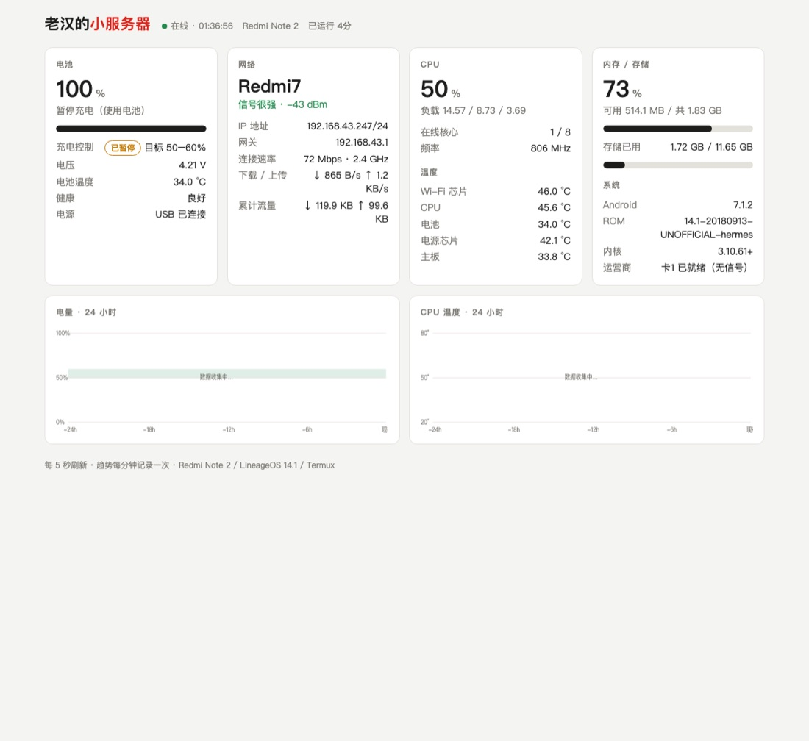
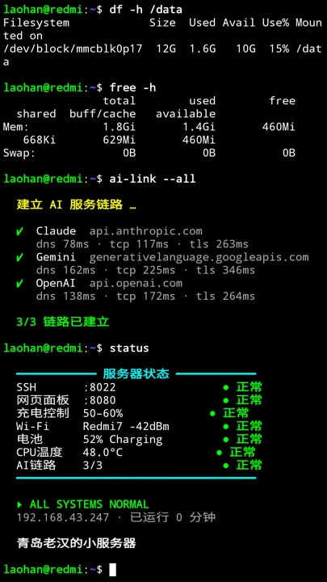
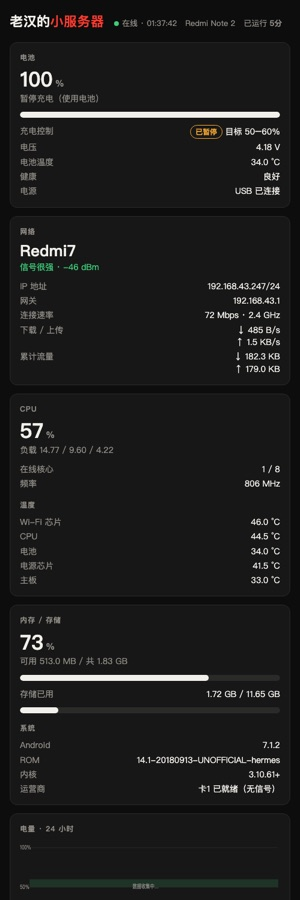

# redmi-note2-server

An old Redmi Note 2 (hermes, MT6795) running as an always-on LAN mini server. It runs LineageOS 14.1 and Termux.

- **Dashboard**: http://192.168.43.247:8080, reachable from anywhere on the LAN. Shows battery, Wi-Fi, CPU, temperatures, memory/storage and 24h trends. Refreshes every 5s.
- **Charge limiter**: keeps the battery between 50% and 60% so that being plugged in all the time doesn't wear out or swell the 2015 battery.
- **SSH**: `ssh -p 8022 192.168.43.247` (Termux, key auth).

## Screenshots

| Status dashboard | Boot animation | Boot intro (Termux) |
|---|---|---|
|  |  |  |

Dashboard on a phone: 

**Boot sound:** [assets/audio/phone_boot.mp3](assets/audio/phone_boot.mp3) (11 s, plays with the progress bar during the boot animation)

**Full step-by-step guide (Chinese, commands explained):** [docs/build-guide.html](docs/build-guide.html)

## Layout

```
system/phonectl.sh     root service: charge limiter + root-only info -> ~/.phonestat.json
system/phonectl.rc     init service definition (/system/etc/init)
termux/webstat/        dashboard (Python stdlib server + one HTML page)
system/termux-services* init-supervised sshd + dashboard (as the Termux uid), survives app kills
tools/build_logo.py    custom first boot screen -> logo partition image
tools/build_bootanim.sh  progress-bar boot animation (+ optional sound)
docs/build-guide.html  full flashing + setup guide
deploy.sh              system | web | all | status
```

## Assets

- `assets/images/`: the user's boot pictures. These are `boot-logo-v1-wodiao.png` and `boot-logo-v2-android.png` (first boot screen → `tools/build_logo.py`), plus `bootanim-v1-laohan.png` and `bootanim-v2-portrait.png` (boot animation → `tools/build_bootanim.sh`).
- `assets/audio/phone_boot.mp3`: the boot sound, an 11 s clip cut in Audacity.
- `docs/img/`: real-device screenshots used by the guide.

Not in git: ROM/TWRP/APK downloads (third-party, too large), the stock MIUI partition backup (2.2 GB, contains device-specific nvram/IMEI data), and generated `bootanimation.zip` / `logo-new.img`. All of these live on `/Volumes/SSD1G/download/redmi-note2-flash/`, and the generated files can be rebuilt from `assets/` with the tools.

## Deploy

```bash
./deploy.sh web      # over SSH; restarts the dashboard
./deploy.sh system   # needs USB + adb root; phonectl reloads at next boot
./deploy.sh status
```

To change the charge window, create `/data/local/phonectl.conf` on the phone (for example `CHARGE_LOW=40` / `CHARGE_HIGH=60`), then reboot. Alternatively run `adb shell 'stop phonectl; start phonectl'`.

## Device quirks

- **Never read `/proc/mtk_battery_cmd/current_cmd`.** Its read handler forces discharging. Write `0 1` to stop charging and `0 0` to resume.
- The kernel's iowait counter is broken. Load average also reads ~15 on an idle phone, so CPU % is computed without iowait.
- Normally only 1 of the 8 cores is online (MTK hotplug).
- SELinux is permissive, which is why `phonectl` can run without its own SELinux domain.
- To reach TWRP, hold Vol Up during a reboot. MIUI-era notes and the full partition backup are in `/Volumes/SSD1G/download/redmi-note2-flash/`.
